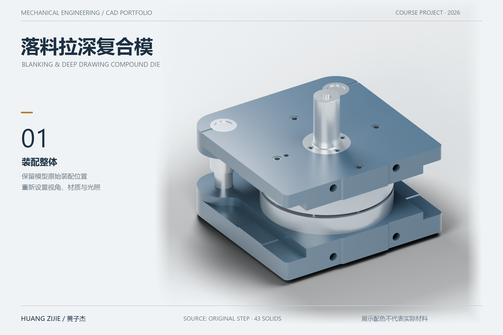
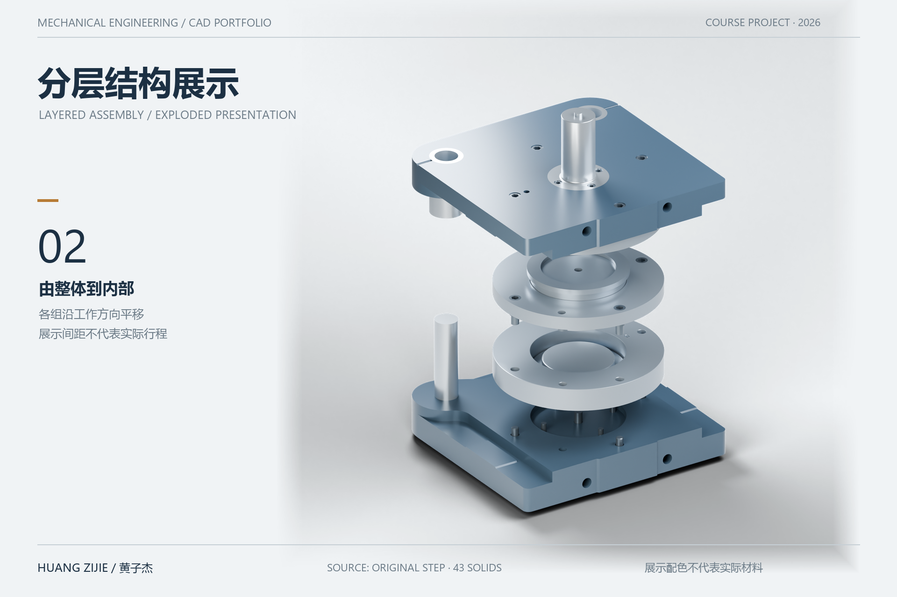
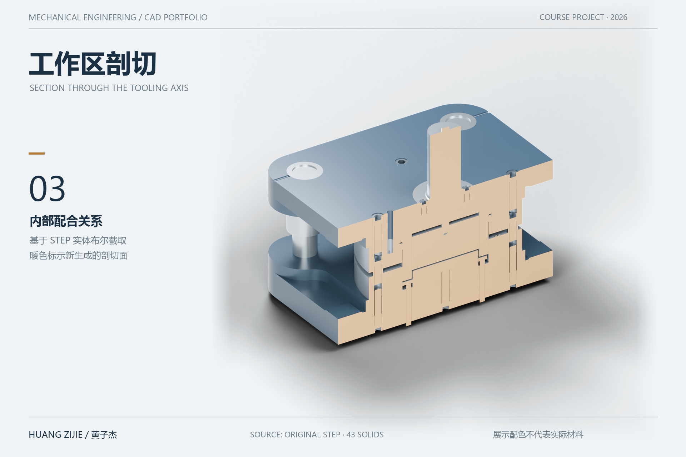
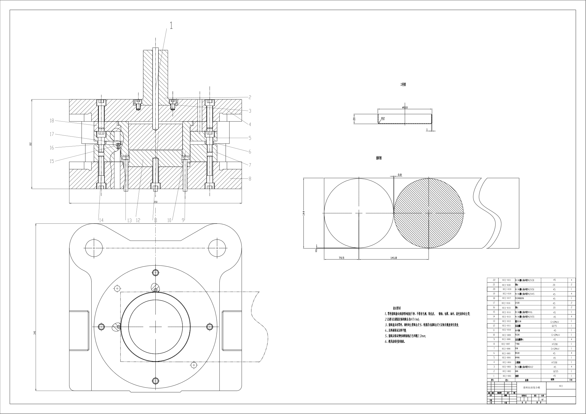
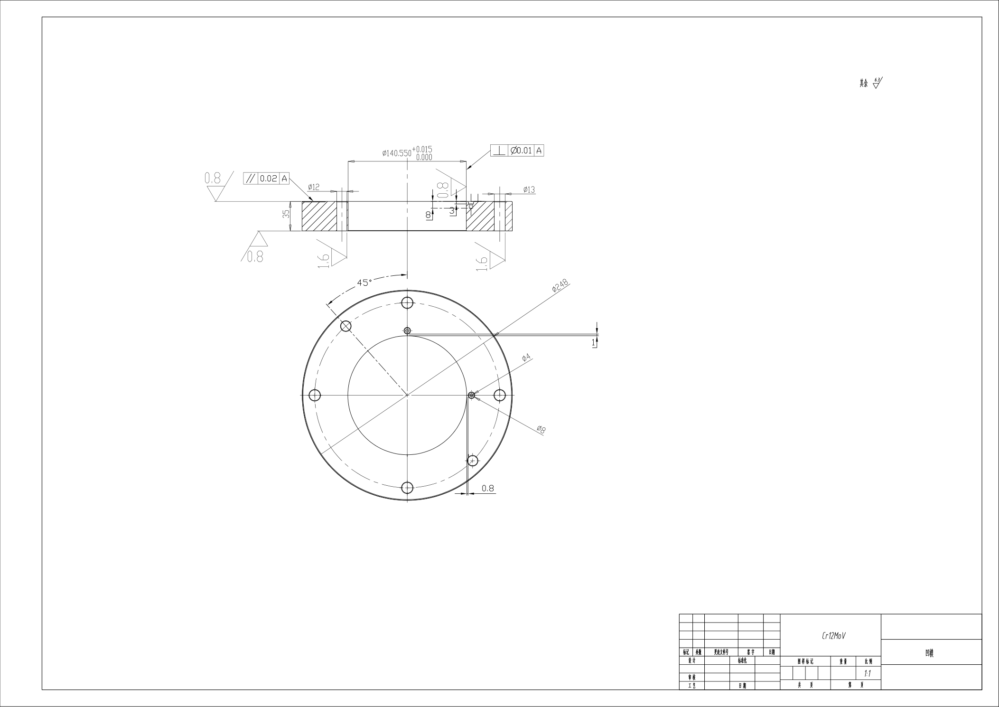
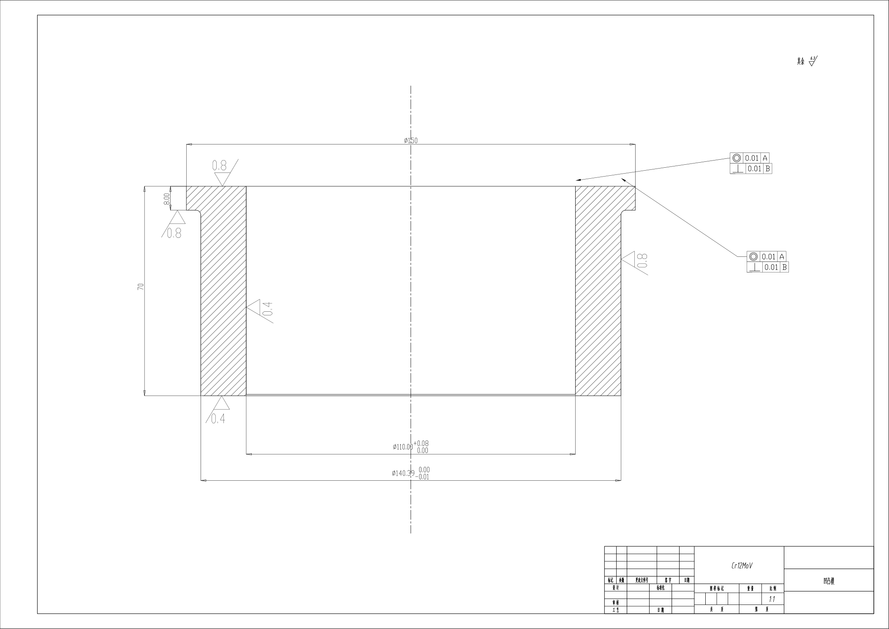

# 落料拉深复合模设计

**Blanking & Deep Drawing Compound Die · Mechanical Engineering Portfolio**

黄子杰｜中国农业大学｜《冲压工艺与模具课程设计》｜2025–2026 学年春季学期

围绕一件厚度为 **1 mm 的不锈钢无凸缘筒形件**，进行冲压工艺分析、落料与拉深工序规划、排样与设备选型，并形成三维模具装配、二维总装图和典型零件图。本仓库收录课程设计成果，并补充一份可追溯的计算复核记录，作为工程岗位求职作品展示。

<p align="center">
  
</p>

> 项目状态：课程设计与 CAD 交付。仓库未提供制造、试模或 CAE 仿真验证证据。原报告存在公式与数值不一致之处，详见[工程复核](docs/engineering-review.md)。

## 快速查看

| 想了解的内容 | 入口 |
| --- | --- |
| 项目思路、计算与设计说明 | [课程设计报告 · 9 页 PDF](docs/design-report.pdf) |
| 模具结构、排样与明细表 | [装配图 PDF](drawings/assembly.pdf) |
| 典型零件尺寸、公差与表面要求 | [凹模图 PDF](drawings/die.pdf) · [凹凸模图 PDF](drawings/punch-die.pdf) |
| 三维几何交付 | [装配 STEP](cad/assembly.step) |
| 二维 CAD 文件 | [装配 DWG](cad/assembly.dwg) · [凹模 DWG](cad/die.dwg) · [凹凸模 DWG](cad/punch-die.dwg) |
| 原报告的问题与复算过程 | [工程复核记录](docs/engineering-review.md) · [计算脚本](scripts/recheck_calculations.py) |

## 工程任务与设计内容

原始制件图包含底部孔系。本项目选择“**落料 + 拉深复合，冲孔另设后续工序**”的方案，展示重点是落料拉深复合模；本仓库没有后续冲孔模具的设计交付。

| 项目 | 原始资料中的参数或方案 |
| --- | --- |
| 材料与厚度 | 1Cr18Ni9Ti，t = 1 mm |
| 筒形件主要尺寸 | 外径 φ110 mm，高度 20 mm，底部圆角 R2 mm |
| 拉深计算直径 | 中径 d = 109 mm |
| 原报告采用的毛坯直径 | D = 141 mm；推导式需复核 |
| 原报告拉深方案 | 一次拉深，设置压边结构；工艺可行性尚未通过试模验证 |
| 排样 | 单直排，步距 141.8 mm，条料名义宽度 144 mm |
| 原报告设备选择 | J23-25，公称压力 250 kN；完整选型仍需复核 |
| CAD 交付格式 | STEP AP203、DWG、PDF；STEP 文件头记录导出工具为 SolidWorks 2024 |

设计说明覆盖材料与结构工艺性、落料和拉深工艺计算、刃口尺寸与间隙、冲压力、排样与裁料方向、压力机选型、模架及标准件选用。CAD 材料进一步展示装配关系、剖视结构、典型零件尺寸及公差标注。

## 三维结构展示

以下图片直接读取本仓库的 STEP 几何后重新渲染，包含 43 个实体。展示配色用于区分结构，不代表实际材料或表面处理；分层图的间距用于阅读，不代表工作行程。原始 CAD 文件保持不变。





渲染方法和重现步骤见[三维展示说明](docs/visualization.md)。

## 装配与零件图



<details>
<summary>展开查看凹模与凹凸模零件图</summary>

### 凹模



### 凹凸模



</details>

## 计算复核与工程判断

2026-11-13 整理公开作品集时，在 AI 辅助下新增了[工程复核记录](docs/engineering-review.md)和 Python 复算脚本。这部分属于本次整理补充，原课程报告的技术内容保留原样。

复算可以重现拉深系数约 **0.773**、两种裁料方向分别 **70 件 / 60 件**，以及落料刃口名义尺寸 **140.55 mm / 140.39 mm** 的算术过程。同时发现原报告的冲压力计算、毛坯公式排版及部分设计尺寸存在不一致，尚不能作为已验证的制造依据。

只需 Python 3，无第三方依赖。在仓库根目录执行：

```bash
python scripts/recheck_calculations.py
```

结果以 JSON 输出，包含来源页码、原报告值和重新计算值。脚本只核查已明确列出的算术与名义参数关系；材料参数、经验系数、模具几何及设备选型仍需要独立工程验证。

对工程评测岗位，这份项目可用于讨论如何从设计任务提取约束、将报告与图纸交叉检查、发现单位或数值不一致，以及区分“有 CAD 交付”和“已验证可制造”的证据边界。仓库尚未构建 AI 自动评分系统或工程 benchmark。

## 文件来源与使用说明

[文件说明](docs/files-and-provenance.md)记录原始文件与公开文件的对应关系、隐私处理及检查范围。[CAD 清单](docs/cad-manifest.json)提供原样收录文件的 SHA-256 校验值。

三维展示图由原始 STEP 几何直接制作，未使用报告截图。PDF 图纸已调整为便于阅读的横向显示。DWG 与 STEP 保留原文件字节；STEP 已通过 Open CASCADE 读取、实体级有效性检查和网格化，但尚未进行原生 CAD 特征重建、装配干涉检查或制造验证。查看模型请下载 STEP 后用支持该格式的 CAD 软件打开。

本仓库用于学习交流和求职展示，未附开放复用许可证。课程题设、标准件及引用资料的权利归原权利人；公开展示不代表对第三方内容作出额外授权。
